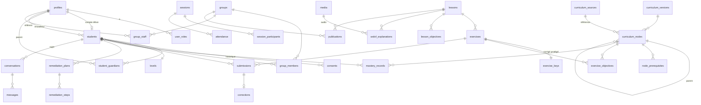

# TERANGA ÉDUCATION — Phase 1.2 : modèle de données

> Version 1.0, 20 novembre 2026.
> Source de vérité : les fichiers SQL de [`../supabase/migrations`](../supabase/migrations). Ce document les explique sans les recopier.

---

## 1. En une phrase

Une base **PostgreSQL** de 54 tables, réparties en 9 domaines. Chaque table est protégée par des règles d'accès appliquées **par la base elle-même** (Row Level Security, 126 règles au total). Le tout a été **testé** en rejouant le scénario de validation T.

## 2. Les 9 domaines

| Domaine | Tables principales | À quoi elles servent |
|---|---|---|
| Identité | `profiles`, `user_roles`, `staff_profiles`, `app_settings` | Qui se connecte, avec quels rôles ; paramètres du centre |
| Organisation | `school_years`, `levels`, `students`, `student_guardians`, `consents`, `rooms`, `subjects` | Dossiers élèves, liens parents, consentements |
| Référentiel | `curriculum_sources`, `curriculum_versions`, `curriculum_node_types`, `curriculum_nodes`, `node_prerequisites` | Programmes officiels **versionnés**, avec leur source et les prérequis |
| Groupes et séances | `groups`, `group_members`, `group_staff`, `sessions`, `session_participants`, `attendance`, `documents` | Affectations datées, emploi du temps, présences |
| Ressources | `sequences`, `lessons`, `lesson_objectives`, `exercises`, `exercise_keys`, `exercise_objectives`, `media`, `wolof_explanations`, `assessments`, `assessment_items`, `publications` | Contenus du centre rattachés au référentiel |
| Suivi | `submissions`, `corrections`, `mastery_records`, `observations`, `reports`, `remediation_plans`, `remediation_steps` | Dossier pédagogique permanent |
| CFEE | `exam_frameworks`, `exam_subjects`, `mock_exams`, `mock_exam_results` | Examen **paramétré** à partir des textes officiels |
| Communication | `conversations`, `conversation_participants`, `messages`, `message_reads`, `notifications`, `help_requests` | Échanges encadrés |
| Traçabilité | `audit_log`, `ai_requests` | Qui a fait quoi ; usage de l'IA |

Plus deux **vues** (`current_mastery` : niveau actuel par élève et objectif ; `students_at_risk` : objectifs non acquis) et des **fonctions** (`submit_answer`, `prerequisite_status`, fonctions d'autorisation).

## 3. Schéma des relations essentielles



## 4. Les choix importants, expliqués simplement

### 4.1 Le référentiel est un arbre « libre » et versionné

Je n'ai pas pu vérifier la hiérarchie exacte du CEB (Phase 0, documents M2 et M3). Je n'ai donc **pas codé** de colonnes « domaine », « compétence » ou « palier ». Le principe est le suivant :

- la coordination déclare les **types de niveaux** tels qu'ils figurent dans le guide officiel (`curriculum_node_types`) ;
- elle saisit ensuite les éléments (`curriculum_nodes`), avec la **source** et la **page** ;
- chaque élément reste marqué **provisoire** jusqu'à vérification sur un document authentifié ;
- quand les nouveaux programmes paraîtront, on créera une **nouvelle version** sans toucher à l'historique des élèves.

### 4.2 Le dossier de maîtrise est un historique

`mastery_records` n'est jamais modifié, seulement complété. Un verrou en base l'interdit, **même au super-administrateur**. C'est ce qui permet de comparer le niveau initial, les niveaux intermédiaires et le niveau récent. La vue `current_mastery` donne le dernier état.

Calcul (paramétrable dans `app_settings`) : après chaque correction, la base prend les 5 dernières corrections de l'élève sur l'objectif et applique les seuils. Chaque calcul conserve ses « preuves » (les corrections utilisées et les seuils appliqués).

### 4.3 Les corrigés sont dans une table à part

`exercise_keys` n'est lisible que par le personnel. Même un élève qui « bricolerait » l'application ne peut pas obtenir les réponses. La note automatique est calculée sur le serveur par la fonction `submit_answer()`.

### 4.4 Les affectations sont datées

`group_members` et `group_staff` ont une date de début et une date de fin. Un encadreur perd automatiquement l'accès à un élève à la fin de son affectation. On garde pourtant la trace de qui a suivi qui, et quand.

### 4.5 Les conflits d'emploi du temps sont impossibles

Deux contraintes d'exclusion empêchent qu'un même encadreur ou une même salle soient réservés sur deux créneaux qui se chevauchent. Ce n'est pas un simple avertissement de l'interface : la base refuse l'enregistrement.

### 4.6 Données minimales sur l'enfant

La fiche élève contient uniquement : nom, prénom, date de naissance, niveau, établissement et classe d'origine, difficultés initiales, date d'inscription, référent, et le compte de connexion facultatif. **Pas** d'adresse, de photo ni de numéro de l'enfant. Le contact est celui du parent (`profiles.phone`), et `student_guardians.is_authorized_contact` indique s'il est autorisé.

## 5. Ce que les tests ont vérifié

Fichier : [`../supabase/tests/10_scenario_validation_et_rls.sql`](../supabase/tests/10_scenario_validation_et_rls.sql). **51 vérifications, toutes réussies**, sur une base PostgreSQL 16 réelle :

- **le scénario T complet**, de T1 à T14 : la compétence passe de *non acquis* à *en cours* puis à *acquis* après la remédiation ;
- **le cloisonnement** : un autre parent, un autre encadreur, un autre élève ou un visiteur non connecté ne voient rien ; un lien parental non validé ne donne aucun accès ;
- **les interdits** : un élève ne lit pas les corrigés et ne fixe pas sa note ; un encadreur ne publie pas vers un groupe qui n'est pas le sien et ne publie pas un contenu non validé ; une explication wolof produite par l'IA et non relue reste invisible ; un plan de remédiation n'est pas validé sans validateur ;
- **les conflits** : encadreur ou salle déjà occupés, double groupe principal ;
- **l'envoi hors-ligne** : un renvoi n'enregistre pas de doublon ;
- **la messagerie** : impossible d'inviter un encadreur non affecté, ou d'écrire au sujet de l'enfant d'un autre ;
- **la traçabilité** : inscriptions et niveaux journalisés avec leur auteur ; journal illisible pour l'encadreur et l'élève.

### Défauts trouvés par les tests, puis corrigés

1. **Publication impossible pour un encadreur.** La règle de lecture cherchait la publication en cours d'enregistrement avant qu'elle n'existe. Elle porte maintenant directement sur les colonnes de la ligne. Le même défaut a été corrigé sur les conversations.
2. **« Dernier niveau » ambigu.** Plusieurs corrections enregistrées dans la même opération portaient la même heure. Un numéro d'ordre strictement croissant (`seq`) a été ajouté.

Ces deux défauts auraient produit des erreurs réelles en Phase 2. C'est l'intérêt de tester le modèle avant de construire l'interface.

### Relancer les tests

```bash
cd teranga-education/supabase
./tests/run_tests.sh   # nécessite PostgreSQL 15+ local ; crée puis supprime « teranga_test »
```

Le fichier `tests/00_supabase_shim.sql` simule le minimum de Supabase (rôles, `auth.uid()`). Il ne doit **jamais** être exécuté sur Supabase.

## 6. Limites connues (traitées dans les phases suivantes)

| Limite | Phase |
|---|---|
| Le contenu d'une leçon est un format en blocs (`jsonb`) dont la structure exacte sera fixée avec l'éditeur | 3 |
| Le masquage de l'aide wolof pendant une évaluation « français obligatoire » est appliqué par l'interface ; il deviendra une règle en base lorsque les sessions d'évaluation chronométrées existeront | 3 |
| Les règles d'accès aux fichiers (Storage) seront écrites avec la même logique que les tables | 2 |
| La création des comptes (`auth.users`) passera par une fonction serveur réservée à l'admin | 2 |
| Les index seront ajustés après des mesures sur un volume réaliste de données fictives | 7 |
